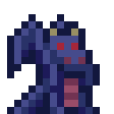

<div align="center">



<h1>JOYGOTCHI</h1>

<p>
  A public gallery of pets that live on chain and on your desktop.
  <br />
  Mint one on NEAR, copy its install code, and it reacts to your coding agent.
</p>

<p>
  <a href="https://joygotchi.vercel.app"><strong>joygotchi.vercel.app</strong></a>
  &nbsp;·&nbsp;
  <a href="https://joygotchi.vercel.app/api/manifest">Manifest API</a>
</p>

</div>

---

## What this is

Three things that fit together:

1. **A web gallery** where every pet on the contract is a page, with the install code you copy.
2. **A CLI** that installs a pet from that code with one command, talking only to a NEAR RPC.
3. **A desktop app** that floats the pet over your editor and animates it on every tool call your
   coding agent makes. With NEAR AI configured it also says something about what just happened.

A pet is an NEP-171 token. The contract is the authority on who owns what, what rarity it rolled
and what level it reached, so nothing in this repository needs a database and there is no account
to make.

## Quick start

Open [joygotchi.vercel.app](https://joygotchi.vercel.app), connect a wallet, and mint a pet for 2
testnet NEAR. The page hands you a code like `jg1_06vwqsthtnk0`.

Or run it yourself:

```sh
git clone https://github.com/joygotchi/joygotchi
cd joygotchi
pnpm install
pnpm dev          # the gallery on http://localhost:5173
```

Either way, then install the pet and run the desktop app:

```sh
npm config set @joygotchi:registry https://npm.pkg.github.com
npm config set //npm.pkg.github.com/:_authToken <a github token with read:packages>
npx @joygotchi/joygotchi install jg1_06vwqsthtnk0
pnpm desktop
```

The first two lines are once per machine. They are needed because the CLI is published to
**GitHub Packages**, not npmjs: npm resolves a scoped name against registry.npmjs.org unless the
scope is pointed elsewhere, and that stays true whatever the package's visibility is. The token is
the part that goes away when the repository — and with it the package — becomes public.

The pet lands in `~/.joygotchi/pets/<slug>/` and the desktop app picks it up.

## How installing works

The code carries the pet's token id and a checksum, and nothing else. It is not a secret and not a
capability — a pet is a token on a public chain, so a code that pretended to grant access would be
theatre. What it does is make an id copyable:

```
jg1_06vwqsthtnk0
 │   └── pet id, scattered across all four bytes, plus a CRC
 └────── format version
```

The id is scattered through a small reversible permutation so that neighbouring pets do not get
codes that look identical — the first cut encoded the id plainly and pets 1, 2 and 3 all read
`jg1_0400000…`, which is how people paste the wrong one. The checksum means a typo fails with
"that install code has a typo in it" rather than quietly installing somebody else's dragon.

`joygotchi install` then decodes the id, asks the contract for the pet, and writes what the
**contract** said — not what the code claimed. The art ships inside the npm package, so an install
needs no CDN, no registry of ours, and no second request that can fail halfway.

## Connecting a coding agent

The desktop app listens on `127.0.0.1:7777`. Any agent, any hook:

```sh
curl -s localhost:7777/event -H 'content-type: application/json' -d '{"kind":"tool-start","tool":"Bash"}'
```

Events are `tool-start`, `tool-end` (with `ok`), `prompt` and `idle`. The port is bound to loopback
and nothing authenticates, which is the whole security model: it cannot be reached from off the
machine.

## Layout

```text
joygotchi/
├── apps/
│   ├── web/          SvelteKit 3 · gallery, pet pages, mint, manifest and AI endpoints
│   └── desktop/      Tauri 2 · Rust shell, Svelte sprite renderer, hook server
├── packages/
│   ├── pet/          The pet package format, install codes, agent→state mapping
│   └── cli/          `joygotchi` — install, list, installed
├── contracts/        Rust · game (NEP-171 pets), pet-stake (AI credits), mint-router
└── docs/             ECONOMY.md, GAME_CONTRACT_V2.md
```

**Web**: SvelteKit 3, Svelte 5 runes, Tailwind 4, `@hot-labs/near-connect` for wallets.<br />
**Desktop**: Tauri 2 — Rust for the window, the hook server and the pet index; Svelte for what is
drawn.<br />
**CLI**: Node 20+, TypeScript, bundled by esbuild into one file with no runtime dependencies,
published as [`@joygotchi/joygotchi`](https://github.com/joygotchi/joygotchi/pkgs/npm/joygotchi) on
GitHub Packages.<br />
**Contracts**: near-sdk 5, built through `cargo near build`.

## The contracts

Deployed on testnet while NEAR Intents is not wired up:

| | |
|---|---|
| game | `jg-game-5656.testnet` |
| pet-stake | `jg-stake-5656.testnet` |
| mint-router | `jg-mint-5656.testnet` |

Minting here goes straight to `create_pet` and pays in NEAR. The `mint-router` path that takes ZEC
or SOL through 1Click settles into the same `create_pet_for`, so turning it on later changes
nothing a page does.

`docs/ECONOMY.md` covers the two-resource design — NEAR in, AI credit earned by staking pets and
spent on feeding, items and inference. `docs/GAME_CONTRACT_V2.md` is the contract spec and the
record of what has been run against testnet.

```sh
pnpm contracts:test     # 103 tests
pnpm contracts:build    # needs cargo-near >= 0.22
```

## NEAR AI

Two endpoints on the web app, both reading the pet off the chain so it cannot be described into
something it is not:

- `POST /api/ai/chat` — talk to a pet on its page.
- `POST /api/ai/react` — one line about what your agent just did, plus the state to animate.

Both need `NEAR_AI_API_KEY`. Without it `/api/ai/chat` answers 503 with a sentence saying so, and
`/api/ai/react` still returns the state to animate and leaves the line `null` — so the desktop pet
moves either way. Everything else — gallery, minting, installing — never touches the key.

```sh
vercel env add NEAR_AI_API_KEY production
```

## Deploying

The web app deploys from the repo root, because `apps/web` depends on `packages/pet` and pnpm
resolves that from the workspace root. `vercel.json` builds the one package and its dependencies,
then hands Vercel the SvelteKit adapter's output.

```sh
vercel deploy --prod
```

`.vercelignore` is doing real work there: without it the upload also walks the Tauri build
directory, three gigabytes of Rust artifacts, and the deploy stalls before it starts.

The repo is private and owned by an organisation, which Vercel's Hobby plan will not connect to
Git — so deploys are from the CLI rather than on push. Making the repo public, or upgrading the
plan, is what turns `vercel git connect` back on. Until then a push changes nothing that is
serving, which is worth remembering before concluding a deploy went wrong.

The web app holds no NEAR signing key. Feed XP is paid by the local oracle, which already has one
— see `apps/oracle/README.md`. The web app only grades.

## Development

```sh
pnpm check      # types across every package
pnpm test       # 62 tests across the JS packages
pnpm build

cd apps/desktop/src-tauri && cargo test    # 6 more, for the hook server and pet index
```

## Where this is going

[`docs/ROADMAP.md`](docs/ROADMAP.md) has the current state, what is waiting on a
decision rather than on work, and the one gap that shapes the rest: our pets
have one drawing each where a petdex pet has nine.

## Licence

MIT. Pet art belongs to its authors.
