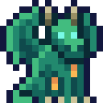

<div align="center">



<h1>JOYGOTCHI</h1>

<p>
  <strong>An on-chain pet that lives on your desktop and plays along while your AI codes.</strong>
  <br />
  Built on NEAR, rebuilt around NEAR AI — play, earn AI credit, create, and trade what you own on chain.
</p>

<p>
  <a href="https://joygotchi.vercel.app"><strong>Play at joygotchi.vercel.app</strong></a>
  &nbsp;·&nbsp;
  <a href="https://joygotchi.vercel.app/download">Download the desktop app</a>
  &nbsp;·&nbsp;
  <a href="https://joygotchi.vercel.app/create">Create a pet</a>
  &nbsp;·&nbsp;
  <a href="docs/ECONOMY.md">The economy</a>
</p>

</div>

---

## What it is

JOYGOTCHI is a virtual pet on the NEAR blockchain, reborn for the age of AI coding assistants.

- **It sits on top of your editor.** A small transparent window holds your pet. Every time your
  coding agent — Claude Code, Codex, or anything that can run a command — reads a file, runs a test,
  fails or waits for you, the pet reacts. It is a companion for the hours you spend pairing with an AI.
- **It talks back with NEAR AI.** Ask it how it is doing and it answers from its real on-chain state.
  It can suggest something to do — feed me, fight, rest — and the app checks the chain before
  anything is signed.
- **It is yours, on chain.** Every pet is an NFT (NEP-171) on NEAR: its rarity, level, stars,
  evolution and owner live in the contract, not on our server. There is no account to make and no
  database to trust.
- **Playing earns.** Put your pet to work in the **AI Lab** and it earns **AI credit**, the
  currency you spend to feed it, buy items and talk to it. [Battle](#battle) other players' pets
  for XP, stars and credit, evolve, collect hats and trade pets and items.
- **Creating earns.** Design a pet of your own, put it on chain, and every time someone mints it you
  are paid. See [For creators](#for-creators).

## The economy: AI credit + play-to-earn

Most play-to-earn games mint a token out of nothing and spend their life defending its price.
JOYGOTCHI has **no game token**. It has two resources:

| | **NEAR** | **AI credit** |
|---|---|---|
| What it is | The chain's own coin | One credit = $1 of real NEAR AI compute |
| You get it | From your wallet, or as a creator | Staking pets in the AI Lab, mining, battles, the faucet |
| You spend it on | Minting pets, registering species, NEAR shop items, buying pets and hats | Feeding, AI chat, credit items, battle wagers |
| Tradeable | Yes | No — credits are consumed for real inference |

Credit is backed by something that exists outside the game: compute the treasury actually bought
on NEAR AI. The staking contract streams it to staked pets by weight, one 30-day **epoch** at a
time, and an epoch only starts when the reserve holds the whole of it. The game cannot pay out
more credit than it can spend on AI.

Where the NEAR goes:

- **Mint** — 2 NEAR a pet (testnet). Revenue is swept to the treasury, which buys the compute
  that becomes credit.
- **Creators** — **1% of every mint** of a species goes straight to the account that registered it.
- **Pet market** — list your pet at any price; the sale moves the NFT and pays you in one
  transaction, with a **2.5%** fee to the treasury.
- **Battles** — the loser pays up to 0.01 credit to the winner, less a 5% cut.

Staking weight grows with rarity, level, stars, evolution phase and shields, sub-linearly, so one
maxed pet cannot crowd out a hundred casual ones. The full design is in
[`docs/ECONOMY.md`](docs/ECONOMY.md).

## For creators

**Your art, on chain, earning from every pet anyone mints of it.**

A species is the kind of pet — the drawing every pet of it wears. Anyone can add one. Once it is
registered, it shows up in the gallery like the dragons we shipped, anyone can mint a pet of it from
any pet's page, and **you are paid 1% of every mint, in NEAR, in the same transaction** — whether the
buyer paid in NEAR or, after mainnet, from another chain through the mint router. There is no
claim step and no middleman: the contract sends it to you.

Two ways to make one, both at [joygotchi.vercel.app/create](https://joygotchi.vercel.app/create):

1. **Recolour a dragon.** Pick a base, turn the hue and saturation, name it and register it. The art
   is a recipe the site renders, so there is nothing to upload.
2. **Submit your own drawing.** Draw a sprite sheet — **8 frames across, 9 states down** (idle,
   running, waving, jumping, failing, waiting, reviewing…), usually 1536 × 1872 px — one sheet per
   evolution phase, up to three. Upload it on the page: the sheet is checked in your browser, stored
   **on NEAR itself** by its hash (you pay its storage once, about 0.3 NEAR for a typical 30 KB
   sheet), and registered as your species. It is the same format [petdex](https://petdex.dev/docs)
   uses, so a sheet made for either works in the other. Prefer the terminal?
   `npx @joygotchi/joygotchi submit ./my-pet` checks the same grid.

Registering costs **5 NEAR**, once — that is what keeps names from being squatted. A species is
permanent: its id is yours, and pets of it point at it for as long as they exist. Pets of a
drawn species animate row by row on the desktop and in the web's state viewer, and every wallet
and explorer draws them from the on-chain art.

## Battle

Pets fight other players' pets, on chain, from the desktop app.

- **Who can fight.** Any two living pets with different owners — a pet at work in the AI Lab
  included. Pick an opponent from the roster, which shows each pet's level, stars and rarity, and
  why the ones you cannot fight right now are out.
- **How a winner is picked.** Your pet's attack against the other's defence. Attack grows 5% a
  level, defence 4% a level, and both 10% a star; each side then rolls within ±15%, so an underdog
  can win. A tie goes to the attacker.
- **What winning gets you.** 25 XP, and the loser's credit wager — up to 0.01 credit, less a 5% cut.
  **Three wins in a row earn a star** (up to five), and stars raise both your odds and your share
  of the AI Lab's credit stream.
- **What losing costs.** A star — unless a **Shield** takes the hit (it is used up) or a **Charm**
  protects it — and three hours off the hunger clock. The pet is **wounded** for six hours, and a
  **Tonic** clears that. Pets never die from a fight.
- **Pacing.** After attacking, a pet rests an hour; after being attacked, it cannot be attacked
  again for an hour. A **Ward** keeps every attacker away for a day.

When somebody else attacks your pet, the desktop app notices from the chain and shows you the
fight — no server, no indexer.

## Items, hats and the things you own

| Kind | Bought with | Examples | What it does |
|---|---|---|---|
| **Shop items** | NEAR | Beef, Water, Shield, Holy Water | Food buys time before your pet starves; a shield absorbs a lost fight (and adds staking weight); Holy Water brings a starved pet back |
| **Credit items** | AI credit | Tonic, Ward, Focus Lens, Charm | Heal a wound, block attacks for a day, boost the XP of your next ten feeds, protect a star |
| **Hats** | NEAR | Pirate, wizard, crown, straw, cap | NFTs of their own — wear one on any pet, trade them on any NEAR NFT market |
| **Pets** | NEAR | Every pet in the gallery | Buy and sell on the built-in market, with the last five sale prices shown |
| **Species** | NEAR | Your own creature | Minted by anyone, paying you 1% — see [For creators](#for-creators) |

## How a day with JOYGOTCHI goes

1. **Pick a pet** in the [gallery](https://joygotchi.vercel.app) and mint one like it — the contract
   rolls the rarity (70% common, 20% rare, 8% epic, 2% legendary).
2. **Put it on your desktop.** [Download the app](https://joygotchi.vercel.app/download) for macOS,
   Windows or Linux, then install the pet with the code on its page.
3. **Code as usual.** Settings connects Claude Code in one click; your pet waves, runs, slumps and
   cheers along with your agent.
4. **Raise it.** Feed it before it starves, send it to the AI Lab to earn credit, claim, mine, fight,
   evolve it through four phases, dress it up.
5. **Trade and create.** Sell a pet, buy a hat, register a species and let the world mint it.

## Quick start

**Play** — open [joygotchi.vercel.app](https://joygotchi.vercel.app), connect a NEAR testnet wallet,
and mint a pet for 2 testnet NEAR.

**Install a pet** with the CLI:

```bash
npx @joygotchi/joygotchi install jg1_06vwqsthtnk0
```

The CLI is published on GitHub Packages, so npm needs to be pointed there once per machine:

```bash
npm config set @joygotchi:registry https://npm.pkg.github.com
npm config set //npm.pkg.github.com/:_authToken "$(gh auth token)"
```

**Connect any agent** — the app listens on `127.0.0.1:7777`:

```bash
curl -s localhost:7777/event -H 'content-type: application/json' -d '{"kind":"tool-start","tool":"Bash"}'
```

Events are `tool-start`, `tool-end` (with `ok`), `prompt` and `idle`. The port is bound to loopback,
so nothing off your machine can reach it.

**Run it yourself:**

```bash
git clone https://github.com/joygotchi/joygotchi
cd joygotchi
pnpm install
pnpm dev          # the web app on http://localhost:5173
pnpm desktop      # the desktop app
```

## How it is built

```text
joygotchi/
├── apps/
│   ├── web/          SvelteKit · gallery, pet pages, mint, market, species creator, NEAR AI endpoints
│   ├── desktop/      Tauri 2 · the pet window, hook server, game panel, wallet session keys
│   └── oracle/       Node · auto-feeds pets on schedule, grades AI meals, watches the treasury
├── packages/
│   ├── pet/          The pet package format, install codes, states, economy constants
│   └── cli/          `joygotchi` — install, list, submit a species
├── contracts/        Rust · game, pet-stake, mint-router, accessory, art
└── docs/             ECONOMY, ROADMAP, MAINNET, contract specs and deploy records
```

| Contract | Testnet account | What it holds |
|---|---|---|
| game | `jg-game-5656.testnet` | Pets (NEP-171), species and creator royalties, battles, the pet market, the NEAR shop |
| pet-stake | `jg-stake-5656.testnet` | The AI credit ledger, the AI Lab, credit items, auto-feed |
| mint-router | `jg-mint-5656.testnet` | Turns a payment from another chain into a pet, royalty included |
| accessory | `jg-acc-5656.testnet` | Hats and wearables, as NFTs |
| art | `art.jg-game-5656.testnet` | Creators' sprite sheets, stored by hash |

Every deployed code hash, and what was run against it, is in
[`contracts/DEPLOYED.md`](contracts/DEPLOYED.md).

**NEAR AI** powers three endpoints on the web app, each reading the pet off the chain first:
`/api/ai/chat` (talk to a pet), `/api/ai/react` (a line about what your agent just did) and
`/api/ai/grade` (how good a meal was, which sets its XP). The model proposes; the app decides —
it never holds a key, and a proposal becomes a transaction only after the chain says it can.

## Where it stands

- **Live on NEAR testnet**: minting in NEAR, the gallery, pet pages with link previews, the market,
  species creation with on-chain art, the desktop app (v0.1.1) and the CLI.
- **Next: mainnet.** Paying from other chains (BTC, ETH, SOL, TRON, TON and more) runs through NEAR
  Intents 1Click, which settles on mainnet only. The pay flow is built; the checklist for moving the
  contracts is [`docs/MAINNET.md`](docs/MAINNET.md).

The rest is in [`docs/ROADMAP.md`](docs/ROADMAP.md).

## Development

```bash
pnpm check                 # types across every package
pnpm test                  # the TypeScript suites
pnpm contracts:test        # the Rust contract tests
pnpm contracts:build       # wasm, needs cargo-near >= 0.22
```

The web app deploys to Vercel on every push to `main`. Desktop releases build on a `desktop-v*`
tag and attach installers to the GitHub release.

## Licence

MIT. Pet art belongs to its authors; action icons are from Raven Fantasy Icons by Clockwork Raven
(see `apps/desktop/public/assets/icon/SOURCE.md`).
